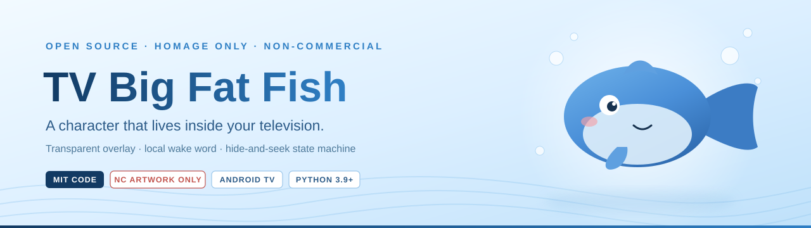
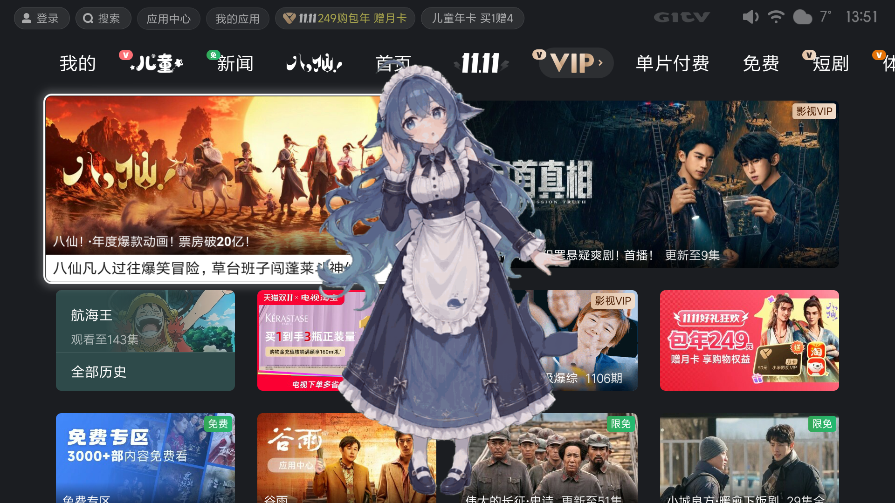
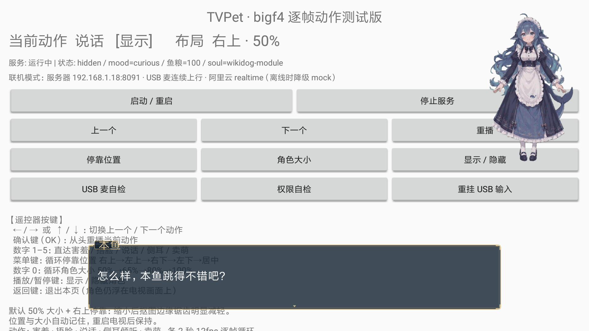
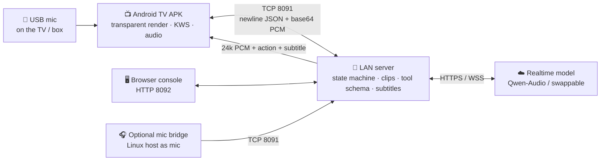

<div align="center">



# 🐟 TV Big Fat Fish

**电视大肥鱼 — a blue, round, slightly lazy fish that lives inside your television.**

Transparent overlay · local wake word · a character that plays hide-and-seek · fully open source · **strictly non-commercial**

<p>
  <a href="LICENSE"></a>
  <a href="#copyright"></a>
  
  
  
  <a href="README.md"></a>
</p>

<p><strong>English</strong> &nbsp;·&nbsp; <a href="README.md"><strong>← 简体中文 version</strong></a> &nbsp;·&nbsp; <a href="#deploy">🚀 Jump to deployment</a></p>

</div>

---

<a id="copyright"></a>

## ⚖️ Read this first: artwork rights and commercial use

> ### 🚨 The character artwork is not ours. We pay homage; we do not commercialize it.
>
> **All artwork copyright and related rights in the character designs remain with their original creators:**
>
> | Creator | Contribution | License status |
> |---|---|---|
> | **上善无形 (Shangshan Wuxing)** | Original character "溟月 / Mingyue" (blue gradient hair, ahoge, whale head fins, large whale tail) | Released for derivatives under **CC BY-NC-SA 4.0**: attribution · **non-commercial** · share-alike |
> | **ZipZipPipe** | The widely circulated "maid whale-girl" design (navy-and-white long maid dress) | Derivative work in the same rights chain; inherits the non-commercial restriction |
> | **这个刀子真甜 (Zhege Daozi Zhen Tian)** | The chibi "Big Fat Fish" design (loves plain rice, silly, lazy) | Derivative work in the same rights chain; the community states explicitly that **commercialization in any form is not permitted** |
> | Other rights holders in the chain | Additional derivative expressions and distributions | All rights reserved |
>
> **This project is a non-commercial, open-source technical experiment.** We do not sell it, run ads, make merchandise, monetize traffic, or grant anyone a commercial license. Character assets in this repository exist **solely as homage and technical demonstration**.

> ### 🔒 Open-sourcing the code does NOT break the artists' restrictions on commercial use
>
> Publishing source code in a public repository means **only** that the code is available under its own license. It does **not** lower, waive, implicitly license, or sublicense the commercial-use barrier on the artwork.
> If the original artists said "no commercialization in any form", that remains true **after** open-sourcing. MIT code and CC BY-NC-SA 4.0 artwork are two independent rights lines; the former cannot override the latter.
>
> We therefore keep them physically separated: **community character packs live in their own directories, carry their own `LICENSE.txt` (CC BY-NC-SA 4.0), and are excluded from the default build** — so the NC term never contaminates the rest of the repository.

> ### 💼 Want to use it commercially? Get the artists' permission yourself.
>
> Any individual, team, or company that wants commercial use of the character designs must **contact each of the artists above (and every other rights holder in the chain) and obtain written commercial authorization**, and must independently satisfy the attribution, non-commercial and share-alike obligations of CC BY-NC-SA 4.0.
>
> This project **provides, transfers, warrants, brokers, and endorses no commercial rights whatsoever**. Disputes, claims, and liabilities arising from commercial use rest entirely with the party using the material.
> If you cannot obtain authorization, the only clean path is: **use the MIT code + the CC0 original geometric fish, and design a fully original character from scratch.**

**Other rights boundaries, stated explicitly:**

| Item | Position |
|---|---|
| Trademarks | "Claude" and the flower mark belong to **Anthropic**; the DeepSeek whale logo and name belong to their owner. This project is **unofficial, unaffiliated, and unlicensed** by either, and does not use their logos as repository art. Related designs are fan art |
| Memes vs. expression | "I am this fish" / "rice = token feed" / slacking off / "fish come here" / "going home to eat plain rice" are **ideas and internet memes**, not copyrightable. What *is* protected is the **specific artistic expression** — which we do not copy |
| Music / motion data | The *Gokuraku Jodo* composition, yurie's distributed VMD motion data, and third-party dance tutorial videos are **not in this repository**. Only self-authored motion parameters and placeholder beats ship; bring your own audio and clear the rights yourself |
| Screenshots | Demo screenshots are for non-commercial illustration only; TV system UI, posters, and other visible content belong to their respective owners |

<a id="license-table"></a>

### 📜 License matrix

| Content | License / status | Commercial use? |
|---|---|---|
| Server / APK / toolchain / build scripts | **MIT** (see `LICENSE`) | ✅ Yes — **only if no protected artwork is bundled** |
| Original geometric "blue round fish", self-authored clip parameters, action schemas | **CC0 / owned** | ✅ Yes |
| Community character packs (`assets/characters/bigf*`, `claude_*`, `dist/*.zip`) | **CC BY-NC-SA 4.0**, all rights reserved by the artists | ❌ **No**, unless you obtain written authorization |
| Demo screenshots in this repository | Non-commercial illustration only | ❌ No |
| Third-party runtime libraries | libpag Apache-2.0 / Godot MIT etc., each under its own license | Per their own terms |
| Music / VMD / third-party video | **Not included** | — |

---

<a id="toc"></a>

## 🗺 Contents

| | | |
|---|---|---|
| [✨ What it is](#what) | [🎬 Real-device demo](#demo) | [🧠 Hide-and-seek](#soul) |
| [🏗 Architecture](#arch) | [🚀 Deployment (step by step)](#deploy) | [🔧 Troubleshooting](#trouble) |
| [⚠️ Platform limits](#limits) | [🛣 Roadmap](#roadmap) | [🤝 Contributing](#contrib) |
| [🙏 Credits](#thanks) | [📄 License](#license) | [🌐 简体中文](README.md) |

---

<a id="what"></a>

## ✨ What it is

TV Big Fat Fish is a **transparent character layer for Android TV / TV boxes**. The character floats above whatever is currently playing, never steals focus, never blocks the remote. Call it and it may peek out — or refuse to appear because it is "eating plain rice".

**It is a technical experiment, not a commercial product, and not an official character of any AI vendor.**

| Feature | Detail |
|---|---|
| 🫧 Full-screen transparent overlay | `TYPE_APPLICATION_OVERLAY` + transparent window; while hidden it is `NOT_FOCUSABLE / NOT_TOUCHABLE`, leaving only a breathing edge light and a tiny fin mark |
| 🎭 Hide-and-seek state machine | `hidden → peek → appear → transition`; whether it comes out is decided by a **state-machine gate**, not a random roll |
| 🎞 Parameterized action library | 14 semantic clips (including the "flash step" exit and "going home for plain rice") mapped onto frame sequences; actions are dispatched by function calls |
| 🎤 Local-first voice | USB mic on the TV/box, local VAD + always-on KWS; **no audio leaves the device before wake**. An optional server-side second mic covers the whole room |
| 📺 Subtitle bubble | RPG-style double-gold-border bubble, whole-sentence display synchronized to the `AudioTrack` playhead, minimum 4 s dwell |
| 🧩 Runs with zero API keys | `provider=mock` validates the entire pipeline (placeholder beeps); real conversation needs a realtime model |
| 🧠 Soul and memory | Reuses `wikidog` soul modules / memory / emotion / proactivity, with automatic fallback to a built-in persona |
| 🔌 Gradle-free build | APK compiled offline with `aapt2 + javac + d8 + zipalign + apksigner`; no Android Studio needed |

<a id="demo"></a>

## 🎬 Real-device demo

<table>
  <tr>
    <td width="58%"></td>
    <td width="42%"></td>
  </tr>
  <tr>
    <td><b>Transparent overlay</b>: the character really stands above the TV's own launcher, without covering content or stealing focus.</td>
    <td><b>Subtitle bubble + motion</b>: in online mode, voice, subtitles and actions all run on one pipeline.</td>
  </tr>
</table>

> Development screenshots, shown for illustration only. Third-party UI and posters visible in the frames belong to their respective owners. Character artwork rights belong to the artists listed above and are **non-commercial**.

<a id="soul"></a>

## 🧠 Hide-and-seek: the most unusual part

"Not coming out" is modeled as **one failed tool call**, not a probability. The model calls `set_visibility`; the server gates it on mood, bond, remaining "rice" (token budget), how many times it was called today, and the temperament defined in the soul.

| State | Visual | Behavior |
|---|---|---|
| `hidden` | Zero character pixels, breathing light / fin mark only | Wake word always on; can talk and speak while "not there" |
| `peek` | Half a head, one eye, or a tail fin at the screen edge | Can duck back any time |
| `appear` | Full character on a fully transparent background | Briefly interactive, otherwise still does not intercept the remote |
| `transition` | Flash-step side dash and hard stop / sliding out with a rice bowl | No new action accepted during the animation (except interrupts) |

| You say | Server verdict | Result |
|---|---|---|
| "Fish, come here" / "come out" | `ok=true` | Flash-step transition → appears |
| "Fish, come here" (8th time today) | `ok=false` + reason "already called eight times" | Breathing light blinks once, the model shrugs it off in character, **no retry** |
| "Add rice" / long neglect | `bond` rises / `proactive` triggers | It peeks out, or shows up on its own |
| "Don't come out" | `hide` | Immediate exit; it respects the user instead of performing |

---

<a id="arch"></a>

## 🏗 Architecture



| Layer | Responsibility | Stack |
|---|---|---|
| TV APK (thin client) | Transparent rendering, frame playback, USB mic capture + local wake, TTS playback, subtitle drawing, settings | Native Android Java, zero third-party deps, minSdk 21 |
| LAN server (heavy backend) | Authoritative visibility state, action orchestration, tool schemas, soul / memory, uplink arbitration, asset delivery | Python 3.9+ stdlib + `websockets` |
| Cloud model (optional) | Realtime voice, function calls, streaming transcripts | Alibaba Qwen-Audio Realtime (verified), other providers pluggable |

> **The server owns the body state; the TV is only a mirror.** Switching devices, reconnecting, or watching from multiple clients needs no protocol change. Moving to WebSocket later changes only the transport, not message semantics.

---

<a id="deploy"></a>

## 🚀 Deployment (from zero to a fish on your TV)

### 0️⃣ Prerequisites

| Item | Requirement | Notes |
|---|---|---|
| Python | **3.9+** | Server uses the stdlib, but `realtime_bridge.py` imports `websockets` at module level — **install it even for MOCK mode**: `python3 -m pip install websockets` |
| TV / box | Android 5.0+ (API 21) | Android TV built-in or an external Android box; ADB debugging must be available |
| Network | TV and server on the **same LAN** | `TCP 8091` (control + audio), `TCP 8092` (console + REST) |
| ADB | Once, on your computer | Only for install and permission grants; turn it off afterwards |
| Android SDK (only for building the APK) | platform `android-33`, build-tools `33.0.2`, JDK 17 | No Android Studio, no Gradle, no network needed |
| USB mic (optional) | Driverless UAC, or TRS 3.5 mm mono mic-in | See the TRRS pitfall in [Troubleshooting](#trouble) |
| Model key (optional) | Alibaba Qwen-Audio Realtime, etc. | **The full MOCK pipeline runs without any key** |

Optional deps (not needed for the core): `numpy` + `opencv-python` + `Pillow` (asset toolchain), `paramiko` (`tools/run_110_mic.py` remote capture).

### 1️⃣ Clone

```bash
git clone https://github.com/verylowlow/TV-dafeiyu.git
cd TV-dafeiyu
python3 -m pip install websockets          # the one runtime dependency — do not skip
```

> ⚠️ Community character packs are **excluded from the default build**. Read the [rights notice](#copyright) before distributing anything, and never push unlicensed artwork into the default build.

### 2️⃣ Start the server (no TV needed yet)

```bash
# Linux / macOS
cd server && bash start.sh

# Windows
server\start.bat

# Or specify ports explicitly
python3 server/tvpet_server.py --config server/config.json --tcp-port 8091 --http-port 8092
```

Success looks like `TVPet P0 服务已启动 / TCP 8091 / HTTP 8092 / 动作库 14 clips`.

```bash
curl http://127.0.0.1:8092/api/health
python3 tools/smoke_test.py 127.0.0.1 8092 8091     # expect: 23/23 passed
```

| `/api/health` field | Healthy value | Meaning |
|---|---|---|
| `ok` / `clips` | `true` / `14` | Action library loaded and validated |
| `clip_problems` | `[]` | First/last keyframes, monotonic time, legal parameters |
| `tcp_clients` | `≥1` once the TV is installed | Connected TVs / mic bridges |
| `uplink_level.peak` | **several hundred or more** while speaking | Single digits (≈5) are just ADC noise floor — no actual pickup |
| `realtime.online` | `true` / `false` | Cloud connection; `false` falls back to MOCK automatically |

### 3️⃣ Browser console (validate motion and visibility without a TV)

| URL | Purpose |
|---|---|
| `http://<server-ip>:8092/` | Main console: state, actions, logs, summon, visibility |
| `/characters.html` | Layered character prototype: character switching, old vs new engine, rig anchors, FPS |
| `/layered.html` | Frame / layered action preview |
| `/api/state` `/api/clips` `/api/tools?provider=openai` | REST: state / action library / function-call tool schema |
| `POST /api/cmd` | Dispatch a command, e.g. `{"cmd":"play_action","args":{"clip_id":"listen_side"}}` |

### 4️⃣ Configuration

`server/config.json`:

| Field | Default | Meaning |
|---|---|---|
| `host` | `0.0.0.0` | Do **not** bind only to `127.0.0.1` or the TV cannot connect |
| `tcp_port` / `http_port` | `8091` / `8092` | Must match the APK settings and firewall rules |
| `provider` | `mock` | Zero-key full pipeline; switch when wiring a realtime provider |
| `api_key` / `voice_id` | empty | Prefer `realtime.env` below; do **not** put keys in `config.json` |
| `character` | `fish` | Original CC0 geometric fish; community packs are explicit opt-in |
| `wake_word` | `鱼来` | Wake phrase |
| `realtime` | `true` | Set `false` to force pure MOCK |

**Optional realtime speech**: `server/realtime.env` is gitignored. Create it with these keys and **never commit it**:

```dotenv
NEWCALLCALL_ALIYUN_REALTIME_API_KEY=your_key
NEWCALLCALL_ALIYUN_REALTIME_BASE_URL=https://your-endpoint
NEWCALLCALL_ALIYUN_REALTIME_MODEL=qwen-audio-3.0-realtime-plus
NEWCALLCALL_ALIYUN_REALTIME_VOICE=longanqian
NEWCALLCALL_ALIYUN_REALTIME_TURN_DETECTION=smart_turn
NEWCALLCALL_ALIYUN_REALTIME_VAD_THRESHOLD=0.5
NEWCALLCALL_ALIYUN_REALTIME_SILENCE_DURATION_MS=600
NEWCALLCALL_ALIYUN_REALTIME_MAX_HISTORY_TURNS=20
```

On Windows use `server\start_realtime.bat`. **If the cloud is unreachable it falls back to MOCK beeps**, so the audio chain can still be validated.
The model only *decides* which action / mood to use — it never generates motion. Every provider shares the same `assets/actions.json` tool schema.

### 5️⃣ Build the APK (offline, no Gradle)

⚠️ **The scripts contain the author's local absolute paths — change them first**: `SDK="E:/android-sdk"`, `BT`, `JDK`, `ROOT="E:/tvpet"` in `tools/build_apk.sh`; `ADB`, `APK`, `TV`, `PKG` in `tools/install_apk.sh`. On Windows run them from Git Bash.

```bash
bash tools/build_apk.sh
# 7 steps: sync assets → aapt2 link → javac → d8 → merge classes.dex → zipalign → apksigner
# Output: build/tvpet-debug.apk (self-signed debug, ready for adb install)
```

> `gradle --offline` **does not work** (AGP cache is missing `org.ow2.asm` and friends) — don't waste time on it. The script bundles only whitelisted assets (currently `bigf4` frame PNGs) and excludes community character packs.
> 🔴 After editing any Java source you **must rebuild and reinstall**; editing files alone changes nothing. Verify all three: source mtime / APK build time / `dumpsys package lastUpdateTime`.

### 6️⃣ Install on the TV

Enable ADB first (on Xiaomi TV: Settings → About → tap "Product model" 7 times → Account & Security → ADB debugging). ⚠️ **Network ADB turns itself off after every reboot** — re-enable it for installation and disable it afterwards (port 5555 is plaintext).

```bash
bash tools/install_apk.sh 192.168.1.5:5555
```

The script: connects → `install -r -t` → `appops set cn.tvpet SYSTEM_ALERT_WINDOW allow` → `pm grant RECORD_AUDIO` → checks for a UAC device → launches `MainActivity`. Manually, if you prefer:

```bash
adb connect 192.168.1.5:5555
adb install -r -t build/tvpet-debug.apk
adb shell appops set cn.tvpet SYSTEM_ALERT_WINDOW allow
adb shell pm grant cn.tvpet android.permission.RECORD_AUDIO
adb shell am start -n cn.tvpet/.MainActivity
```

> 🔴 **Xiaomi TVs show a system "install confirmation" dialog**; `adb install` waits silently until a watchdog kills it at ~100 s. At 1920×1080 the "OK" button is at `(720, 662)`: `adb shell input tap 720 662`. Multiple dialogs stack — tap a few times.
> **Open the app manually once**: Android 12+ forbids starting a microphone foreground service directly from `BOOT_COMPLETED`.

### 7️⃣ Point the TV at the server

1. In the settings page, set "server IP" to the **LAN IP of the machine running the server** (e.g. `192.168.1.18`) — **not `127.0.0.1`**.
2. Tap "Save & start" → "USB mic self-check" → "Permission self-check". The check lists devices, sample rate, noise floor and echo.
3. Open the firewall: on Windows all three profiles are on with no inbound rules by default — **allow TCP 8091 / 8092** or the TV will not connect.
4. Say the wake word, or just talk: `uplink_level.peak` should jump into the hundreds, and the subtitle bubble plus an action should appear on screen.

### 8️⃣ Optional: use a LAN Linux host as the microphone

Fallback when the TV's USB port does not enumerate UAC. `tools/host_mic_bridge.py` has no third-party dependencies (only `arecord` from alsa-utils), sends 20 ms frames of 16k PCM16, and applies half-duplex gating to avoid feedback; the server arbitrates uplink sources (`host-mic` wins).

```bash
python3 tools/host_mic_bridge.py --list                                  # list capture devices
python3 tools/host_mic_bridge.py --host <server-ip> --port 8091 --device plughw:2,0
```

### 9️⃣ Acceptance checklist

| Check | Expected |
|---|---|
| `curl <server-ip>:8092/api/health` | `ok=true`, `clips=14`, `tcp_clients≥1` |
| `python3 tools/smoke_test.py` | `23/23 passed` |
| Speak | Correct ASR → whole-sentence subtitle → character plays an action → audio out |
| Function call | Logs show `play_dance` / `set_visibility` / `set_mood` mapped to real frame clips |
| MOCK mode | Downlink is a **placeholder beep**, not TTS — expected |

---

<a id="trouble"></a>

## 🔧 Troubleshooting

| Symptom | Cause | Fix |
|---|---|---|
| `ModuleNotFoundError: websockets` on startup | Top-level import in `realtime_bridge.py`; MOCK mode needs it too | `python3 -m pip install websockets` |
| TV cannot reach 8091 | Firewall / `127.0.0.1` entered on TV / wrong bind address | Allow 8091 + 8092, use the LAN IP, `host=0.0.0.0` |
| `adb install` hangs ~100 s | Xiaomi install-confirmation dialog | `adb shell input tap 720 662`; repeat for stacked dialogs |
| Character invisible | Overlay permission not granted | `appops set cn.tvpet SYSTEM_ALERT_WINDOW allow` |
| Zero pickup (`peak≈5`) | A 4-pole TRRS phone headset plugged into a TRS mono mic-in jack; no bias return path | Get a **CTIA** TRRS-female → dual 3.5 mm male splitter, or use a USB mic / PC dual-plug headset |
| No response to speech | Cloud session expires after 180 s idle; uplink frames are dropped during reconnect | Auto-reconnect is implemented; wait a few seconds and keep talking |
| Subtitle flashes away | Source edited but APK not rebuilt / consecutive replies reset the previous line | Rebuild with `build_apk.sh` and reinstall (see the three timestamps in 5️⃣) |
| Overlay cannot cover HDMI input | Platform limit: an overlay cannot cover a cross-device signal source | **Install the APK on the same Android device that produces the picture** (the box, if external) |
| `gradle --offline` fails | Incomplete AGP cache | Use `tools/build_apk.sh` |
| ADB gone after reboot | Xiaomi disables network ADB on every boot | Re-enable ADB debugging |
| Character disappears after standby | `killAllThirdApp` kills third-party apps | Standby means "the character rests"; open the app once after power-on |

<a id="limits"></a>

## ⚠️ Hard TV platform limits (measured — don't re-test)

| Limit | Mitigation |
|---|---|
| Overlay cannot cover a different HDMI input source | APK and picture source must be on the same Android device |
| Overlay permission has **no tappable switch** on CN-region TVs | ADB `appops` only; already in the install script |
| Network ADB 5555 resets on reboot and is plaintext | Enable only during installation, then disable |
| Replacing the launcher black-screens (CN ROM blocks `com.mitv.tvhome`) | No launcher replacement |
| Some TV USB ports **only enumerate storage, not audio** | Self-check + three fallbacks: Bluetooth voice remote / phone as mic / LAN capture host |
| WOL cannot wake this Xiaomi TV; power-on needs the physical remote | Standby is explicitly "the character rests"; no wake-from-standby feature |
| `MediaProjection` captures the character itself | Visual Q&A is P2; hide the character layer ~300 ms before a single-frame capture |

<a id="roadmap"></a>

## 🛣 Roadmap and honest limitations

| Phase | Goal | Status |
|---|---|---|
| **P0 · Skeleton** | Transparent APK, TCP protocol, 14 clips, hide-and-seek gate, full MOCK pipeline, browser console, 23/23 smoke tests | ✅ Done |
| **P1 · Alive** | Qwen-Audio Realtime, function-call actions, subtitle bubble, USB mic / capture-host uplink, half-duplex gating | ✅ Verified on real hardware (bring your own key) |
| **P2 · Beautiful** | 80–150 clips, layered blend trees, libpag / mesh deformation, flash-step transitions, screen vision | 🔨 In progress |
| **P3 · Community** | Character-pack spec, action contribution toolchain, multi-provider capability negotiation, demo site | 📋 Planned |

**Honest list**: P0 wake is an **energy gate**, not keyword spotting (P1 switches to openWakeWord / Sherpa-ONNX). AEC uses only the system `AcousticEchoCanceler`; adaptive cancellation against downlink PCM is not implemented. No libpag / 3D / alpha video yet. MOCK voice is a synthetic beep, not TTS. Community packs still have `rig_calibrated:false`; nine rigs, the Android GLES port, and real-device performance measurements are unfinished.

<a id="contrib"></a>

## 🤝 Contributing

**The easiest contribution is an action, not code.** A clip is one JSON entry in `assets/clips.json` plus optional frame assets; `tools/smoke_test.py` validates first/last keyframes, monotonic timing, and legal parameters.

| Please do | Please don't |
|---|---|
| Add action clips, fix rig anchors, improve the state machine, adapt new providers, fix docs | Submit **any unlicensed artwork**, music, VMD motion data, third-party video, or film/TV screenshots |
| Submit **fully original** character packs (CC0 / CC BY 4.0) | Merge community packs into the default build, or delete their standalone `LICENSE.txt` |
| Report TV model compatibility and UAC self-check results | Commit API keys, voice samples, or user recordings (`realtime.env` is gitignored) |
| Correct us on license wording, the rights chain, or platform limits | Use this project for commercial promotion, sponsorship revenue, merchandise, or a paid app listing |

Run `python3 tools/smoke_test.py` before opening a PR, and state whether your change touches the asset directories.

<a id="thanks"></a>

## 🙏 Credits and attribution

| Party | Relationship |
|---|---|
| **上善无形**, **ZipZipPipe**, **这个刀子真甜**, and every other artist in the rights chain | Hold **all artwork rights**. We offer homage only, non-commercially; we claim no artwork rights and grant no commercial sublicense |
| The "Big Fat Fish" meme and its community derivative ecosystem | Inspiration. We borrow the meme and its semantics, never the specific artistic expression |
| `wikidog` | Source of the soul / memory / body-interface protocol reused here |
| Tencent `libpag`, Godot, Alibaba Qwen Realtime | Toolchain and model capabilities (each under its own license) |
| Anthropic / DeepSeek | Trademark and meme-origin references only — unofficial, unaffiliated, unlicensed |

---

<a id="license"></a>

## 📄 License

**MIT for code · artwork belongs to its artists · non-commercial throughout.**

See [`LICENSE`](LICENSE), [`NOTICE.md`](NOTICE.md), and the [license matrix](#license-table). One last time: **open-sourcing the code does not break the artists' restrictions on commercial use. If you want to commercialize it, go get the artists' permission yourself.**

<div align="center">

<sub>🐟 This fish lives in your TV. It does not eat commercial feed.</sub>

</div>
