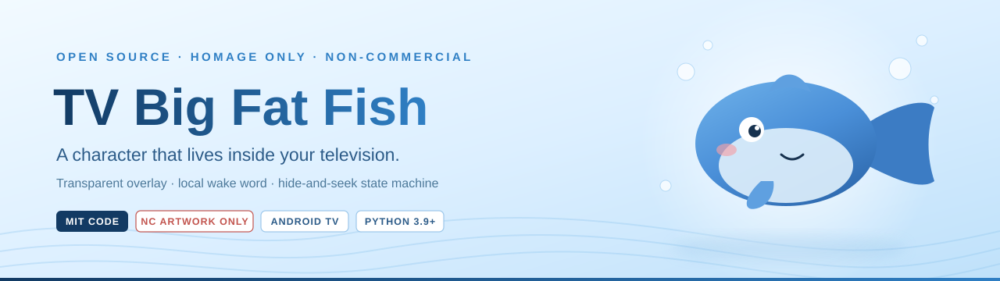
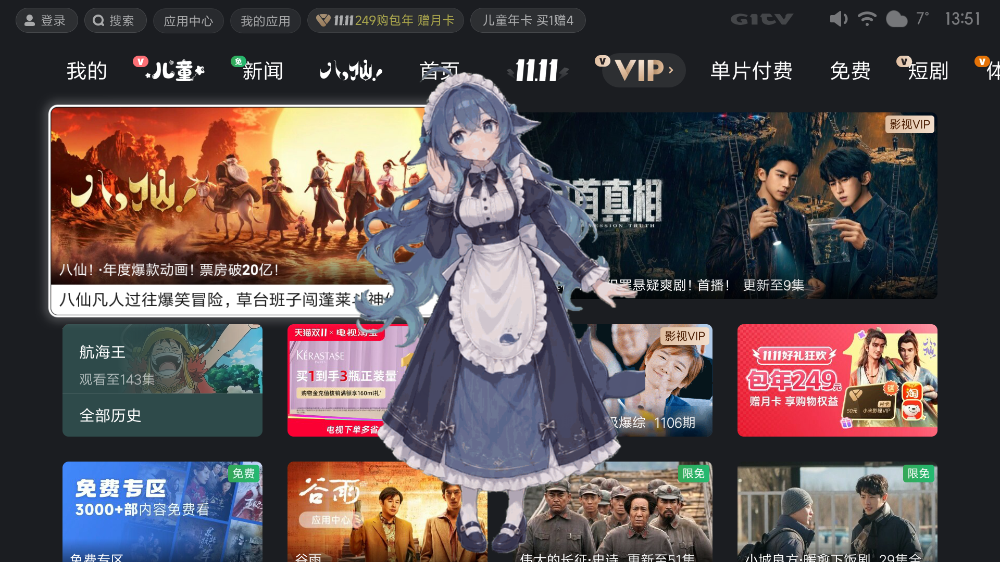
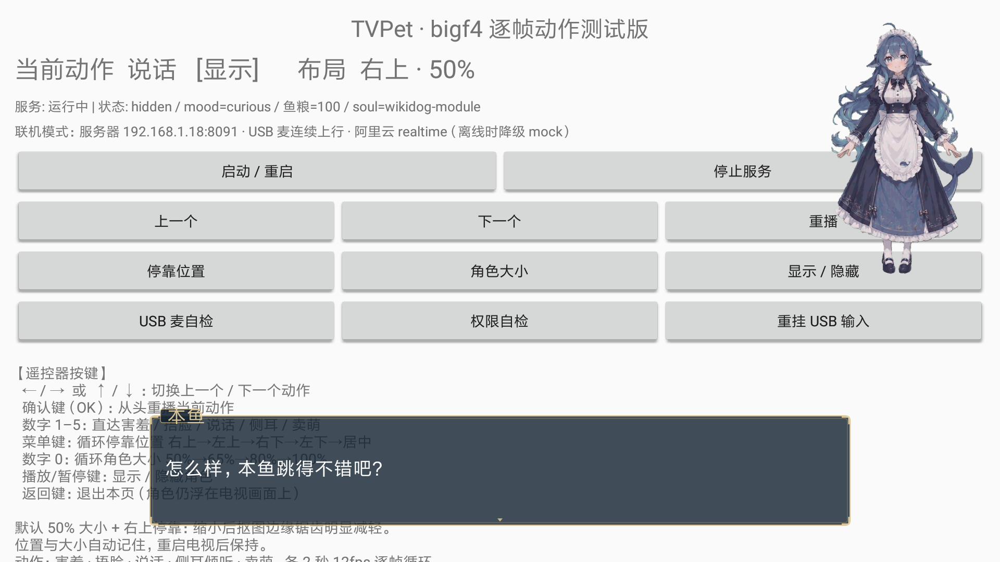
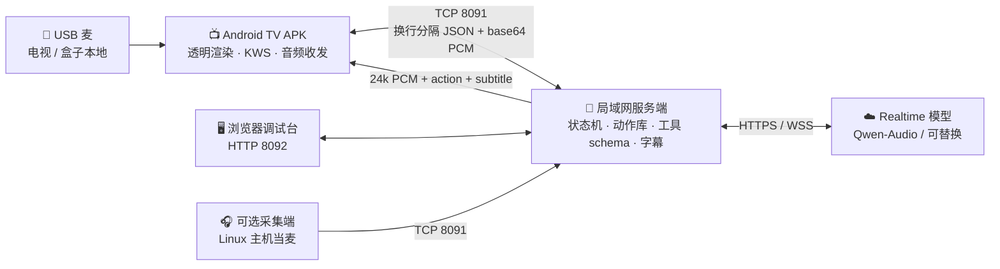

<div align="center">



# 🐟 电视大肥鱼

**让一条蓝色大肥鱼，住进你家电视里。**

透明悬浮层 · 本地语音唤醒 · 会躲猫猫的角色 · 完全开源 · **永不商用**

<p>
  <a href="LICENSE"></a>
  <a href="#copyright"></a>
  
  
  
  <a href="README.en.md"></a>
</p>

<p><a href="README.en.md"><strong>English version →</strong></a> &nbsp;·&nbsp; <strong>简体中文</strong> &nbsp;·&nbsp; <a href="#deploy">🚀 直接看部署</a></p>

</div>

---

## ⚖️ 请先读这一段：美术权益与商用边界

<a id="copyright"></a>

> ### 🚨 角色美术不是我们的。我们致敬，但不商用。
>
> 角色形象的**美术著作权及相关权益，归原作者所有**：
>
> | 原作者 | 贡献 | 授权状态 |
> |---|---|---|
> | **上善无形** | 原创角色「溟月」（蓝色渐变长发、呆毛、鲸类头鳍、大鲸尾） | 以 **CC BY-NC-SA 4.0** 开放二创：署名 · **非商业** · 相同方式共享 |
> | **ZipZipPipe** | 女仆鲸鱼娘形象（深蓝白女仆长裙） | 版权链上的衍生成果，沿用原作非商业约束 |
> | **这个刀子真甜** | 二头身 Q 版「大肥鱼」定型（爱吃白饭、爱犯傻、爱偷懒） | 版权链上的衍生成果，社区明确「不可以任何形式商业化」 |
> | 版权链上的其他权利人 | 其余二创、配布与衍生表达 | 权利各自保留 |
>
> **本项目是一个非商业的开源技术实验**：不售卖、不接广告、不做周边、不引流变现、不授权任何商业使用。仓库里的角色素材仅用于**致敬与技术演示**。

> ### 🔒 开源不会打破原作者对商用的约束
>
> 把代码放进公开仓库，**只代表代码按其自身许可开放**。它**不代表**美术素材的商用门槛被降低、被豁免、被默示许可或被转授。
> 原作者说「不可以任何形式商业化」，开源之后**依然不可以**。代码 MIT 与素材 CC BY-NC-SA 4.0 是两条独立的权利线，前者不能覆盖后者。
>
> 因此本项目主动做了物理隔离：**社区形象包单独目录 + 单独 `LICENSE.txt`（CC BY-NC-SA 4.0）+ 默认构建不包含**，避免 NC 条款传染整个仓库。

> ### 💼 想商用？自己去拿授权
>
> 任何个人、团队或公司若想把角色形象用于商业目的，必须**自行逐一联系上述美术作者及版权链上的其他权利人，取得书面商业授权**，并自行履行 CC BY-NC-SA 4.0 的署名、非商业、相同方式共享等义务。
>
> 本项目 **不提供、不转让、不担保、不代办** 任何商用权利，也不对任何第三方使用行为背书。因商用引发的纠纷、索赔与责任，由商用者自行承担。
> 若无法取得授权，唯一干净的路是：**只用仓库里的 MIT 代码 + CC0 原创几何形象，重新设计一套完全原创的角色**。

**其它权利边界，同样写死：**

| 事项 | 立场 |
|---|---|
| 商标 | 「Claude」及花形标志属 **Anthropic**；DeepSeek 蓝鲸 Logo 与名称属其权利人。本项目与二者**非官方、无关联、未授权**，不使用其 Logo 作仓库图标。相关形象为 fan art |
| 梗与设定 | 「本鱼 / 白饭 = 鱼粮 / 摸鱼 / 鱼来鱼来 / 赶回家吃白饭」属**思想与网络梗**，不受著作权保护；受保护的是**具体美术表达**，我们不复制具体表达 |
| 音乐 / 动作数据 | 《极乐净土》词曲、yurie 配布的 VMD 动作、他人舞蹈教学录像 **一律不入库**。仓库只分发自写的动作参数与节拍占位；音频、动作数据请自备并自行取得授权 |
| 截图 | 演示截图仅作非商业说明；画面中出现的电视系统 UI、影视海报等权利归各自权利人 |

<a id="license-table"></a>

### 📜 许可分层一览

| 内容 | 许可 / 状态 | 可商用？ |
|---|---|---|
| 服务端 / APK / 工具链 / 构建脚本 | **MIT**（见 `LICENSE`） | ✅ 可以，**前提是不带任何受保护美术素材** |
| 原创几何「蓝色圆胖鱼」、自写 clip 参数、动作 schema | **CC0 / 自有** | ✅ 可以 |
| 社区角色形象包（`assets/characters/bigf*`、`claude_*`、`dist/*.zip`） | **CC BY-NC-SA 4.0**，原作者保留全部权利 | ❌ **不可以**，除非你自行取得书面授权 |
| 仓库内演示截图 | 仅限非商业说明 | ❌ 不可以 |
| 第三方运行时库 | libpag Apache-2.0 / Godot MIT 等，各自许可 | 按各自许可 |
| 音乐 / VMD / 他人录像 | **不入库** | — |

---

<a id="toc"></a>

## 🗺 目录

| | | |
|---|---|---|
| [✨ 它是什么](#what) | [🎬 真机效果](#demo) | [🧠 躲猫猫机制](#soul) |
| [🏗 架构](#arch) | [🚀 部署（逐步）](#deploy) | [🔧 排障](#trouble) |
| [⚠️ 平台硬限制](#limits) | [🛣 路线图](#roadmap) | [🤝 贡献](#contrib) |
| [🙏 致谢](#thanks) | [📄 许可](#license) | [🌐 English](README.en.md) |

---

<a id="what"></a>

## ✨ 它是什么

电视大肥鱼是一个**跑在安卓电视 / 电视盒子上的透明角色层**：角色浮在正在播放的画面之上，不抢焦点、不挡遥控器；你喊一声，它可能探头，也可能因为「在吃白饭」拒绝现身。

**它是技术实验，不是商业产品，也不是任何 AI 厂商的官方形象。**

| 特性 | 说明 |
|---|---|
| 🫧 全屏透明悬浮 | `TYPE_APPLICATION_OVERLAY` + 透明窗口，隐身时 `NOT_FOCUSABLE / NOT_TOUCHABLE`，只留边缘呼吸灯与小鳍标记 |
| 🎭 捉迷藏状态机 | `hidden → peek → appear → transition`，能否叫出来由**状态机 gate** 决定，不是随机数 |
| 🎞 参数化动作库 | 14 个语义 clip（含「闪身步」退场、「赶回家吃白饭」）+ 逐帧素材映射，动作由 function call 下发 |
| 🎤 本地优先的语音 | USB 麦插电视 / 盒子，本地 VAD + KWS 常听；**唤醒前音频不出设备**；服务器侧全屋唤醒为可选第二路 |
| 📺 字幕气泡 | RPG 风格双金边气泡，按 `AudioTrack` 播放头同步整句显示，短句最少驻留 4 秒 |
| 🧩 零 key 可跑 | `provider=mock` 全链路可验收（蜂鸣占位音）；接上 Qwen-Audio Realtime 才是真正对话 |
| 🧠 灵魂与记忆 | 复用 `wikidog` 的灵魂模块 / 记忆 / 情绪 / 主动性，失败自动降级内置人格 |
| 🔌 零 Gradle 构建 | APK 用 `aapt2 + javac + d8 + zipalign + apksigner` 手工离线编译，不需要 Android Studio |

<a id="demo"></a>

## 🎬 真机效果

<table>
  <tr>
    <td width="58%"></td>
    <td width="42%"></td>
  </tr>
  <tr>
    <td><b>透明悬浮层</b>：角色真的站在电视自带桌面之上，不遮挡内容、不抢焦点。</td>
    <td><b>字幕气泡 + 角色动作</b>：联机模式下，语音、字幕、动作由同一条链路驱动。</td>
  </tr>
</table>

> 截图为开发期真机测试画面，用于说明效果；画面内第三方 UI 与海报权利归各自权利人。角色美术权利归上文所列原作者，**非商用**。

<a id="soul"></a>

## 🧠 躲猫猫：这是它最特别的地方

「叫不出来」被设计成**一次失败的工具调用**，而不是概率事件：模型调用 `set_visibility`，服务端按心情、亲密度、鱼粮余量、当日被叫次数、灵魂里的脾气做 gate 判定。

| 状态 | 画面 | 行为 |
|---|---|---|
| `hidden` | 0 像素角色，仅呼吸灯 / 小鳍标记 | 唤醒词常开，能对话、能出声，但「不在」 |
| `peek` | 屏幕边缘露出半个头 / 一只眼 / 尾鳍 | 随时缩回 |
| `appear` | 完整角色，背景完全透明 | 短暂可交互，其余时间不拦截遥控器 |
| `transition` | 闪身步侧移急停 / 端碗滑出画外 | 动画期间不接受新动作（打断级除外） |

| 你说 | 服务端判定 | 结果 |
|---|---|---|
| 「鱼来」「出来」 | `ok=true` | 闪身步转场 → 现身 |
| 「鱼来」（今天第八次） | `ok=false` + 中文理由「刚被叫过八次了」 | 呼吸灯闪一下，模型一句话带过，**不重试** |
| 「加饭」/ 长时间没理它 | `bond` 提高 / `proactive` 触发 | 自己探头，甚至自己现身 |
| 「别出来了」 | `hide` | 立刻退场，尊重用户，不演 |

---

<a id="arch"></a>

## 🏗 架构



| 层 | 职责 | 技术 |
|---|---|---|
| 电视 APK（轻前端） | 透明渲染、逐帧动作播放、USB 麦采集与本地唤醒、TTS 播放、字幕绘制、配置页 | Android 原生 Java，零第三方依赖，minSdk 21 |
| 局域网服务端（重后端） | 显隐身权威状态、动作编排、工具 schema、灵魂 / 记忆、上行源仲裁、素材下发 | Python 3.9+ 标准库 + `websockets` |
| 云端模型（可选） | 实时语音、function call、字幕流 | 阿里云 Qwen-Audio Realtime（已跑通），可换 provider |

> **身体状态由服务端持有，电视只是镜像**：换端、断线重连、多端同看都不用改协议。P1 换 WebSocket 时消息语义一行不改，只换传输层。

---

<a id="deploy"></a>

## 🚀 部署（从零到电视上那条鱼）

### 0️⃣ 前置条件

| 项 | 要求 | 说明 |
|---|---|---|
| Python | **3.9+** | 服务端用标准库；但 `realtime_bridge.py` 顶层 `import websockets`，**即使 MOCK 模式也要装**：`python3 -m pip install websockets` |
| 电视 / 盒子 | Android 5.0+ (API 21) | 自带安卓电视或外接安卓盒子，需能开 ADB 调试 |
| 网络 | 电视与服务器**同一局域网** | `TCP 8091`（控制 + 音频）、`TCP 8092`（调试台 + REST） |
| ADB | 本机装一次 | 只用于装机与授权，装完可关 |
| Android SDK（仅编译 APK 时） | platform `android-33`、build-tools `33.0.2`、JDK 17 | 不需要 Android Studio、不需要 Gradle、不需要联网 |
| USB 麦（可选） | 免驱 UAC，或 TRS 3.5mm 单声道 mic-in | 见 [排障](#trouble) 里 TRRS 插头的坑 |
| 模型 key（可选） | 阿里云 Qwen-Audio Realtime 等 | **不填也能跑完整 MOCK 链路** |

可选依赖（只跑核心不用装）：`numpy` + `opencv-python` + `Pillow`（角色素材工具链）、`paramiko`（`tools/run_110_mic.py` 远程采集）。

### 1️⃣ 拉代码

```bash
git clone https://github.com/verylowlow/TV-dafeiyu.git
cd TV-dafeiyu
python3 -m pip install websockets          # 唯一运行期依赖，别漏
```

> ⚠️ 社区形象包默认**不在构建白名单里**。若你要分发，先读完 [版权声明](#copyright)，别把未授权素材塞进默认构建。

### 2️⃣ 起服务端（电视关机也能先跑通）

```bash
# Linux / macOS
cd server && bash start.sh

# Windows
server\start.bat

# 或手动指定端口
python3 server/tvpet_server.py --config server/config.json --tcp-port 8091 --http-port 8092
```

看到 `TVPet P0 服务已启动 / TCP 8091 / HTTP 8092 / 动作库 14 clips` 即成功。

```bash
curl http://127.0.0.1:8092/api/health
python3 tools/smoke_test.py 127.0.0.1 8092 8091     # 期望：结果 23/23 通过
```

| `/api/health` 字段 | 健康值 | 含义 |
|---|---|---|
| `ok` / `clips` | `true` / `14` | 动作库加载且校验通过 |
| `clip_problems` | `[]` | clip 首末帧、时间单调、参数合法性 |
| `tcp_clients` | 装好电视后 `≥1` | 电视 / 采集端在线数 |
| `uplink_level.peak` | 说话时**几百以上** | 个位数（≈5）只是 ADC 本底噪声，等于没拾到音 |
| `realtime.online` | `true` / `false` | 云端是否连上；`false` 自动降级 MOCK |

### 3️⃣ 浏览器调试台（不开电视就能验证动作与显隐身）

| 地址 | 用途 |
|---|---|
| `http://<服务器IP>:8092/` | 主控制台：状态、动作、日志、召唤、显隐身 |
| `/characters.html` | 角色分层原型：多角色切换、新旧引擎对比、锚点标定、FPS |
| `/layered.html` | 逐帧 / 分层动作预览 |
| `/api/state` `/api/clips` `/api/tools?provider=openai` | REST：状态 / 动作库 / function-call 工具 schema |
| `POST /api/cmd` | 下发命令，如 `{"cmd":"play_action","args":{"clip_id":"listen_side"}}` |

### 4️⃣ 配置

`server/config.json`：

| 字段 | 默认 | 说明 |
|---|---|---|
| `host` | `0.0.0.0` | 监听地址，别只绑 `127.0.0.1`，否则电视连不上 |
| `tcp_port` / `http_port` | `8091` / `8092` | 与 APK 配置页、防火墙保持一致 |
| `provider` | `mock` | 零 key 全链路；接 realtime 时改为对应 provider |
| `api_key` / `voice_id` | 空 | 建议**不要**写进 `config.json`，用下面的 `realtime.env` |
| `character` | `fish` | 原创 CC0 几何鱼；社区形象包需显式 opt-in |
| `wake_word` | `鱼来` | 唤醒词 |
| `realtime` | `true` | 关掉可强制纯 MOCK |

**接实时语音（可选）**：`server/realtime.env` 已被 `.gitignore` 忽略，按下面键名自建，**绝不提交**：

```dotenv
NEWCALLCALL_ALIYUN_REALTIME_API_KEY=你的key
NEWCALLCALL_ALIYUN_REALTIME_BASE_URL=https://你的接入点
NEWCALLCALL_ALIYUN_REALTIME_MODEL=qwen-audio-3.0-realtime-plus
NEWCALLCALL_ALIYUN_REALTIME_VOICE=longanqian
NEWCALLCALL_ALIYUN_REALTIME_TURN_DETECTION=smart_turn
NEWCALLCALL_ALIYUN_REALTIME_VAD_THRESHOLD=0.5
NEWCALLCALL_ALIYUN_REALTIME_SILENCE_DURATION_MS=600
NEWCALLCALL_ALIYUN_REALTIME_MAX_HISTORY_TURNS=20
```

Windows 用 `server\start_realtime.bat` 启动。**连不上会自动降级 MOCK 蜂鸣**，音频链路仍可单独验收。
模型只负责决策「播哪个动作 / 什么情绪」，不生成动作；所有 provider 共用同一套 `assets/actions.json` 工具 schema。

### 5️⃣ 编译 APK（离线、零 Gradle）

⚠️ **脚本头部是作者本机的绝对路径，先改成你自己的**：`tools/build_apk.sh` 里的 `SDK="E:/android-sdk"`、`BT`、`JDK`、`ROOT="E:/tvpet"`；`tools/install_apk.sh` 里的 `ADB`、`APK`、`TV`、`PKG`。Windows 用 Git Bash 执行。

```bash
bash tools/build_apk.sh
# 7 步：同步 assets → aapt2 link → javac → d8 → 合并 classes.dex → zipalign → apksigner
# 产物：build/tvpet-debug.apk（自签 debug，可直接 adb install）
```

> `gradle --offline` **不可用**（AGP 依赖缓存缺 `org.ow2.asm` 等），别浪费时间。脚本只带白名单素材（当前为 `bigf4` 逐帧 PNG），默认不含社区形象包。
> 🔴 改完 Java 源码**必须重跑本脚本并重新装机**，光改文件不生效。核对三件套：源码 mtime / APK 构建时间 / `dumpsys package lastUpdateTime`。

### 6️⃣ 装到电视

先开 ADB：小米电视「设置 → 关于本机 → 产品型号连点 7 次 → 账号与安全 → ADB 调试」。⚠️ **网络 ADB 每次重启会自动关闭**，装机时重开，用完关掉（5555 明文不安全）。

```bash
bash tools/install_apk.sh 192.168.1.5:5555
```

脚本依次做：连接 → `install -r -t` → `appops set cn.tvpet SYSTEM_ALERT_WINDOW allow` → `pm grant RECORD_AUDIO` → UAC 设备自检 → 启动 `MainActivity`。也可手工：

```bash
adb connect 192.168.1.5:5555
adb install -r -t build/tvpet-debug.apk
adb shell appops set cn.tvpet SYSTEM_ALERT_WINDOW allow
adb shell pm grant cn.tvpet android.permission.RECORD_AUDIO
adb shell am start -n cn.tvpet/.MainActivity
```

> 🔴 **小米会弹「安装确认」系统对话框**，`adb install` 会静默等到约 100s 被看门狗杀掉。1920×1080 下「确定」坐标是 `(720, 662)`，用 `adb shell input tap 720 662` 点掉；多个对话框会堆叠，多点几次。
> 首次请**手动打开一次 App**：Android 12+ 不允许从 `BOOT_COMPLETED` 直接起 microphone 前台服务。

### 7️⃣ 电视上填地址并自检

1. 配置页「服务器 IP」填**跑服务端那台机器的局域网 IP**（如 `192.168.1.18`）——**不是 `127.0.0.1`**。
2. 点「保存并启动」→「USB 麦自检」→「权限自检」。自检页会列出设备、采样率、底噪、回声。
3. 放行防火墙：Windows 三个 profile 默认全开且无入站规则，**务必放行 TCP 8091 / 8092**，否则电视连不上。
4. 喊一声「鱼来」，或对着麦说话：`uplink_level.peak` 应跳到几百以上，电视出现字幕气泡与动作。

### 8️⃣ 可选：用局域网 Linux 主机当麦克风

当电视 USB 口不认 UAC 时的兜底路径。`tools/host_mic_bridge.py` 零第三方依赖，只需系统有 `arecord`（alsa-utils），20ms 一帧 16k PCM16 上行，带半双工门控防自激；服务端自动做上行源仲裁（`host-mic` 优先）。

```bash
python3 tools/host_mic_bridge.py --list                                  # 列出可用 capture 卡
python3 tools/host_mic_bridge.py --host <服务器IP> --port 8091 --device plughw:2,0
```

### 9️⃣ 验收清单

| 检查 | 期望 |
|---|---|
| `curl <服务器IP>:8092/api/health` | `ok=true`、`clips=14`、`tcp_clients≥1` |
| `python3 tools/smoke_test.py` | `23/23 通过` |
| 说话 | ASR 正确 → 字幕整句出现 → 角色播动作 → 出声 |
| function call | 日志出现 `play_dance` / `set_visibility` / `set_mood` 并映射到实际逐帧 clip |
| MOCK 模式 | 下行是**蜂鸣占位音**，不是 TTS，属正常 |

---

<a id="trouble"></a>

## 🔧 排障速查

| 症状 | 根因 | 处置 |
|---|---|---|
| 启动即 `ModuleNotFoundError: websockets` | `realtime_bridge.py` 是顶层 import，MOCK 模式也需要 | `python3 -m pip install websockets` |
| 电视连不上 8091 | 防火墙 / 填了 `127.0.0.1` / `host` 绑错 | 放行 8091、8092；填局域网 IP；`host=0.0.0.0` |
| `adb install` 卡住约 100s | 小米弹安装确认框 | `adb shell input tap 720 662`，多框多戳几次 |
| 角色不显示 | 悬浮窗权限未授 | `appops set cn.tvpet SYSTEM_ALERT_WINDOW allow` |
| 拾音全 0（`peak≈5`） | 手机 4 极 TRRS 耳麦插进 TRS 单声道 mic-in，偏置回路不通 | 买 **CTIA** 标准 TRRS 母→双 3.5mm 公分线器，或换 USB 免驱麦 / PC 双插头耳麦 |
| 说话没反应 | 云端 180s 无 response 会话作废，重连窗口内上行帧被丢 | 已改为主动重建会话；等几秒再说，保持持续交互 |
| 字幕一闪而过 | 改了源码没重编译 / 模型连续回复时 `reset` 顶掉上一句 | 重跑 `build_apk.sh` 并装机（见 5️⃣ 的三件套） |
| 角色盖不住 HDMI 输入画面 | 平台硬限制，跨设备悬浮窗盖不住外接信号源 | **APK 必须装在与画面同源的那台安卓设备**（外接盒子就装盒子） |
| `gradle --offline` 失败 | AGP 依赖缓存不全 | 用 `tools/build_apk.sh` |
| 重启后 ADB 连不上 | 小米网络 ADB 每次重启自动关 | 重新打开 ADB 调试 |
| 待机后角色消失 | 系统 `killAllThirdApp` 强杀第三方 App | 待机定义为「角色休息」；开机手动打开一次 App |

<a id="limits"></a>

## ⚠️ 电视平台硬限制（实测，别重复踩）

| 限制 | 对策 |
|---|---|
| 悬浮窗盖不住别的 HDMI 输入源 | APK 与画面必须在同一台安卓设备 |
| 悬浮窗权限在国行 TV 上**没有可点的开关** | 只能 ADB `appops` 授权，装机脚本已包 |
| 网络 ADB 5555 每次重启自动关且明文 | 只在装机时开，用完关 |
| 换启动器会黑屏（国行禁 `com.mitv.tvhome`） | 不做 launcher 替换 |
| 部分电视 USB 口**只认存储、不识别声卡** | 自检 + 三条兜底：蓝牙语音遥控器 / 手机当麦 / 局域网采集端 |
| WOL 唤不醒小米电视，开机必须物理遥控器 | 待机态明确定义为「角色休息」，不做「喊一声开机」 |
| MediaProjection 抓屏会把角色自己截进去 | 视觉问答属 P2，抓单帧前临时隐藏角色层 |

<a id="roadmap"></a>

## 🛣 路线图与已知限制

| 阶段 | 目标 | 状态 |
|---|---|---|
| **P0 · 骨架** | 透明 APK、TCP 协议、14 clip、捉迷藏 gate、MOCK 全链路、浏览器调试台、冒烟 23/23 | ✅ 已跑通 |
| **P1 · 活** | Qwen-Audio Realtime 接入、function call 动作、字幕气泡、USB 麦 / 采集端上行、半双工门控 | ✅ 已真机跑通（云 key 自备） |
| **P2 · 美** | 80–150 clip、分层混合树、libpag / 网格形变、闪身步转场、屏幕视觉 | 🔨 进行中 |
| **P3 · 开源** | 形象包规范、动作贡献工具链、多 provider 能力协商、演示站 | 📋 计划中 |

**诚实清单**：P0 唤醒是「能量门」而非关键词唤醒（P1 换 openWakeWord / Sherpa-ONNX）；AEC 只用系统 `AcousticEchoCanceler`，下行 PCM 参考尚未做自适应抵消；暂未上 libpag / 3D / 透明视频；MOCK 语音是合成蜂鸣，不是 TTS；社区形象包 `rig_calibrated:false`，锚点未逐个标定；9 份 rig、Android GLES 迁移、真机性能实测未完成。

<a id="contrib"></a>

## 🤝 贡献

**社区最容易贡献的是动作，不是代码** —— 一个 clip 就是一份 `assets/clips.json` 里的 JSON + 可选逐帧素材，`tools/smoke_test.py` 会校验首末帧、时间单调与参数合法性。

| 可以做 | 不要做 |
|---|---|
| 新增动作 clip、修正 rig 锚点、改进状态机、适配新 provider、修文档 | 提交任何**未取得授权的美术素材**、音乐、VMD 动作数据、他人录像或影视截图 |
| 提交**完全原创**的形象包（CC0 / CC BY 4.0） | 把社区形象包并进默认构建，或删除其独立 `LICENSE.txt` |
| 提 issue 报告电视机型兼容性与 UAC 自检结果 | 提交任何 API key、音色样本、用户录音（`realtime.env` 已 gitignore） |
| 帮我们挑错：许可措辞、版权链、平台限制 | 用本项目做商业推广、赞助变现、周边、上架收费应用 |

PR 前请跑 `python3 tools/smoke_test.py`，并在描述里注明是否触及素材目录。

<a id="thanks"></a>

## 🙏 致谢与署名

| 对象 | 关系 |
|---|---|
| **上善无形**、**ZipZipPipe**、**这个刀子真甜** 及版权链上的其他美术作者 | 角色美术权益的全部权利人。本项目**仅致敬、非商用**，不主张任何美术权利，也不代授任何商用许可 |
| 「大肥鱼」梗与社区二创生态 | 灵感来源；只借用梗与设定语义，不复制具体美术表达 |
| `wikidog` | 灵魂 / 记忆 / 身体接口协议的复用来源 |
| Tencent `libpag`、Godot、阿里云 Qwen Realtime | 工具链与模型能力（各自许可） |
| Anthropic / DeepSeek | 仅为商标与梗源说明，非官方、无关联、未授权 |

---

<a id="license"></a>

## 📄 许可

**代码 MIT · 美术归原作者 · 全项目非商用。**

见 [`LICENSE`](LICENSE)、[`NOTICE.md`](NOTICE.md) 与 [许可分层](#license-table)。一句话重申：**把代码开源，不会打破原作者对商用的约束；想商用，自己去争取美术作者的授权。**

<div align="center">

<sub>🐟 本鱼住在电视里，不吃商业化的鱼粮。</sub>

</div>
